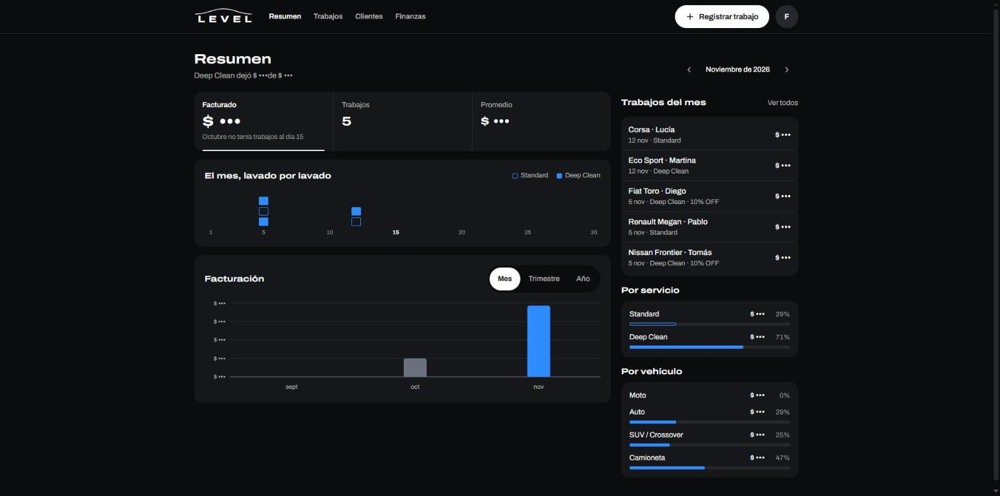
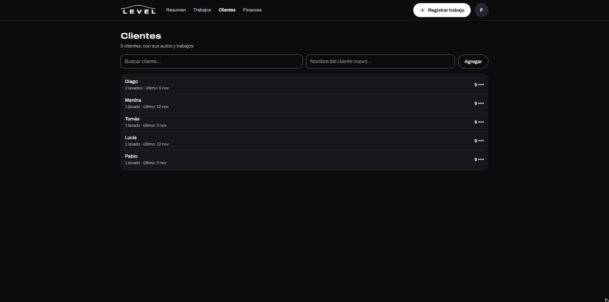
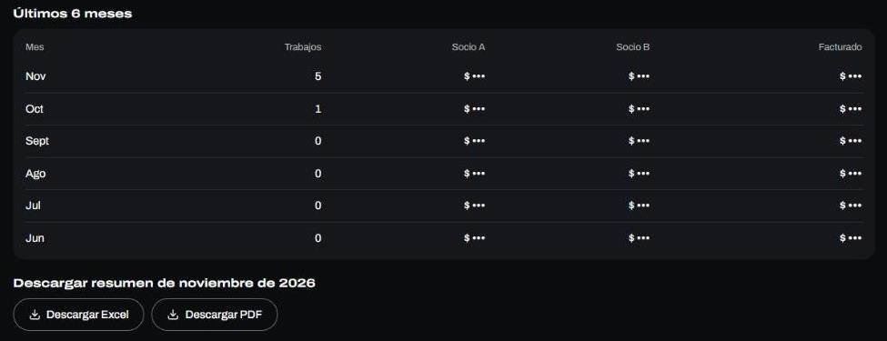

# LEVEL — Sistema de gestión para un lavadero de autos

LEVEL es el sistema interno de un emprendimiento de lavado de autos por turnos que llevo adelante con un socio. Lo diseñé y desarrollé, y lo usamos en la operación diaria.

> El código es privado y la app requiere inicio de sesión. Este repositorio documenta el proyecto. En las capturas, los nombres de clientes y socios fueron reemplazados por nombres de ejemplo y los montos están ocultos.

## ✨ Funcionalidades

- **Resumen mensual**: facturación, cantidad de trabajos, promedio por lavado y comparación con el mes anterior.
- **Gráficos** de facturación por mes, trimestre y año, y desglose por servicio y por tipo de vehículo.
- **Registro de trabajos** con servicio, vehículo y descuentos.
- **Ficha de clientes** con historial: cantidad de lavados, último lavado y total facturado.
- **Finanzas**: reparto de ingresos entre socios, ajustes, seguimiento de deudas y exportación del resumen a **PDF y Excel**.
- **Inicio de sesión con roles de usuario**.

## 🛠️ Stack

React · TypeScript · Vite · Tailwind CSS · Supabase (PostgreSQL, Auth) · Recharts · Vercel

## 👤 Mi rol

Co-fundador del emprendimiento y desarrollador del sistema, de punta a punta.
